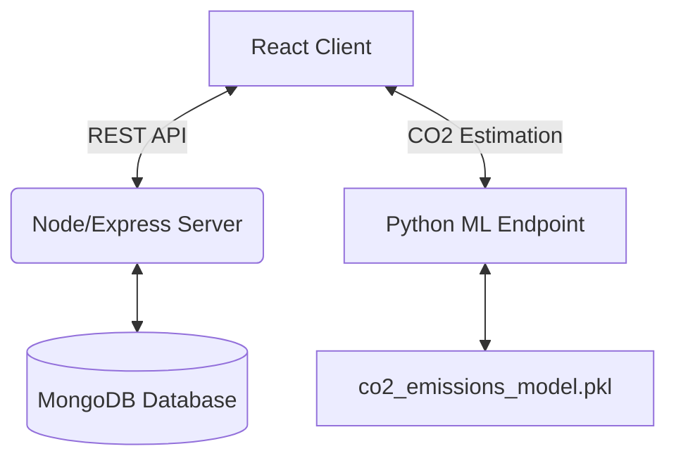

<div align="center">
  
  <h1>🌿 EcoVoyage</h1>
  <p><em>Your intelligent and eco-friendly travel companion</em></p>
</div>

<br />

## 📖 About EcoVoyage

**EcoVoyage** is a comprehensive web application designed to help users plan their travels sustainably. By integrating an advanced Machine Learning model with a seamless, user-friendly interface, it calculates and predicts CO₂ emissions based on your transportation choices, empowering you to make greener decisions. Users can also discover new destinations, securely manage their accounts, and review their carbon footprint.

---

## ✨ Key Features

- **🌍 Sustainable Route Planning:** Plan your journey and get immediate estimates on your trip's environmental impact.
- **🤖 Machine Learning Integration:** Predicts CO₂ output of vehicles based on make, model, vehicle class, and fuel type using a custom-trained Scikit-Learn regression model.
- **🗺️ Interactive Maps:** Uses Google Maps API to help visualize routes, destinations, and local eco-friendly travel options.
- **🔐 Secure Authentication:** Seamless login/signup system with JWT, and Google OAuth2 integration securely managed by Passport.js.
- **📱 Responsive UI:** Built with React, Material-UI, and Swiper for a gorgeous application experience on across screens and devices.

---

## 🛠️ Technologies Used

| Category | Technologies |
| --- | --- |
| **Frontend** | React (v18), React Router Dom, Material-UI, Google Map React, Swiper, Axios |
| **Backend** | Node.js, Express.js, MongoDB, Mongoose |
| **Authentication** | Passport.js (Google OAuth2), JSON Web Tokens (JWT), bcrypt |
| **Machine Learning** | Python, Pandas, Scikit-Learn, Joblib, Flask (Endpoint) |

---

## 🏗️ Project Architecture



The application is structured into three main directories:
1. `/client`: Contains the React-based frontend user interface, pages and map interactions.
2. `/server`: The Node.js backend handling user data, secured authentication, token validation, and API routing.
3. `/MLmodel`: Houses the Python predictive model and API endpoint estimating vehicle CO₂ footprints per route or type.

---

## 🚀 Getting Started

Follow these steps to set up the project locally on your machine.

### Prerequisites
- [Node.js](https://nodejs.org/) (v16+ recommended)
- [MongoDB](https://www.mongodb.com/) (Local or Atlas URI)
- [Python 3.x](https://www.python.org/) and pip (for the ML backend)

### 1. Clone the repository
```bash
git clone https://github.com/your-username/ecovoyage.git
cd ecovoyage
```

### 2. Set up the Backend (Server)
```bash
cd server
npm install
```
Create a `.env` file in the `/server` directory and add your environment variables:
```env
PORT=5000
MONGO_URI=your_mongodb_connection_string
JWT_SECRET=your_jwt_secret
GOOGLE_CLIENT_ID=your_google_client_id
GOOGLE_CLIENT_SECRET=your_google_client_secret
```
Run the development server:
```bash
npx nodemon index.js
```

### 3. Set up the Frontend (Client)
Open a new terminal session.
```bash
cd client
npm install
```
Start the React development server:
```bash
npm start
```

### 4. Set up the ML Model
Open a new terminal session.
```bash
cd MLmodel
pip install pandas scikit-learn joblib flask
```
Run the learning script and start the endpoint:
```bash
python app.py       # Trains and dumps the model to .pkl
python endpoint.py  # Starts the Python server and predictions
```
